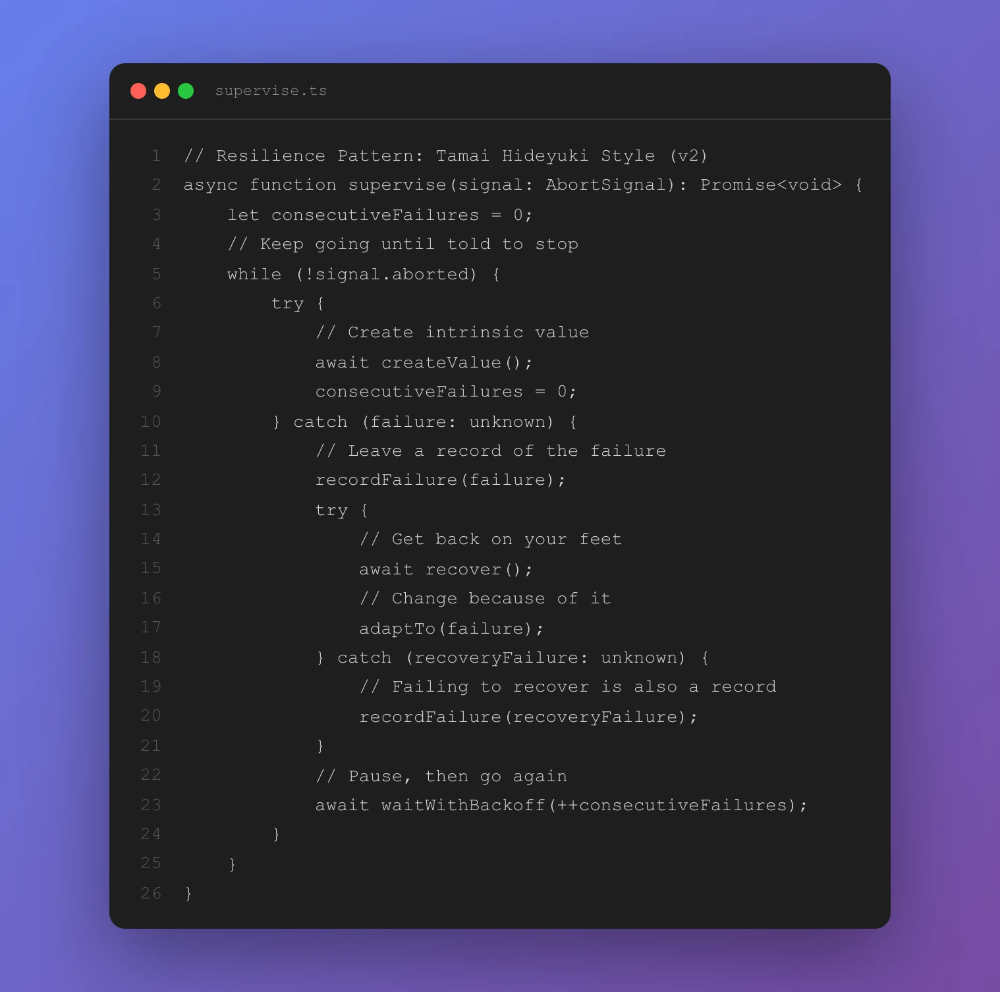

<!-- Typing Banner -->

  

  

---

<h2 align="center">最近の開発</h2>

| リポジトリ名 | 説明 |
|--------------|------|
| [heyawari](https://github.com/tamai-hideyuki/heyawari) | 会議室の予約管理システム。二重予約をアプリ側のチェックではなく、PostgreSQL の排他制約（`EXCLUDE USING gist` + `tstzrange`）で防ぐことを設計の中心に置き、同時リクエストの競合を DB で確実に止める。Hono + Drizzle + React（TanStack Router / Query）の pnpm モノレポ構成 |
| [stardust-notes](https://github.com/tamai-hideyuki/stardust-notes) | 書いた言葉が星になるメモ帳。保存すると文字が粒子に分解されて星になり、共通キーワードを持つメモ同士が星座として結ばれる（WebGL）。シードと時計を固定して描画を再現可能にし、ユニット / ブラウザ / Playwright E2E のテストで見た目の挙動まで検証 |
| [brain-cabinet](https://github.com/tamai-hideyuki/brain-cabinet) | ノートの意味を理解し、思考の成長を可視化する「外部脳」。ローカル埋め込み（MiniLM + HNSW）によるセマンティック検索、SM-2 による間隔反復、思考の変化を追う Drift 分析などを実装。React + Three.js / Hono / SQLite + Drizzle のモジュラーモノリス構成で、CI とテストを備えて継続開発中 |

---

<h2 align="center">🧰 技術スタックバッジ</h2>

  <!-- 🐍 バックエンド -->
  
  
  
  
  

  <!-- 🎨 フロントエンド -->
  
  
  
  
  
  

  <!-- 🖥️ スクリプト -->
  
  

  <!-- 🧱 フレームワーク -->
  
  
  
  

  <!-- 🛠️ インフラ・自動化 -->
  
  
  
  
  
  
  

  <!-- 📱 PWA・オフライン -->
  
  
  

  <!-- ⚖️ 法・RAG・解析 -->
  
  
  
  
  
  

  <!-- 🖥️ コア技術 -->
  
  
  

  <!-- 📚 その他 -->
  
  
  
  
  
  

---
#### [English ☞](./docs/README.en.md)

<h2 align="center">🌱 目指す開発エンジニア像</h2>
私は、プロダクト開発を通じて、課題を発見し、技術をもってその解決に取り組むエンジニアを志しています。

エンジニアリングとは、単なる技術の適用ではなく、本質的な課題と向き合い、より良い在り方を問い続ける営みだと捉えています。
その中で私は、日々の開発を通じて「なぜこの仕様なのか」「何が最も価値に結びつくのか」を自ら考え、手を動かしながら、よりよい選択肢を模索し続ける姿勢を大切にしています。

技術的な関心も多岐にわたりますが、特定の分野にこだわるのではなく、プロダクトの価値を高めるために必要な知識やスキルを柔軟に吸収し、成長し続けることを信条としています。

また、開発は一人では成し得ません。心理的安全性や情報の透明性を意識し、変化を歓迎する姿勢で、チームとして成果を出すことにも力を注ぎたいと考えています。

将来的には、設計・実装だけでなく、プロダクト全体の品質や成長に関わる意思決定にも貢献できるよう、エンジニアとしての視座と影響範囲を広げていくことを目指しています。

---

<h2 align="center">✅ Tamai Hideyuki — Repository Snapshot</h2>

## 🧠 AI・意味検索・ローカル LLM

| リポジトリ名 | 説明 |
|--------------|------|
| [semantica-notes](https://github.com/tamai-hideyuki/semantica-notes) | メモを「意味」で整理・検索するパーソナルナレッジベース。Sentence-Transformers（LaBSE）+ FAISS による意味検索を、クリーンアーキテクチャ + DDD（Domain / UseCase / Interface / Infrastructure）で構築 |
| [rfc-chronicle](https://github.com/tamai-hideyuki/rfc-chronicle) | IETF の RFC を取り込み、SQLite FTS5 の全文検索と Sentence-Transformers + FAISS の意味検索を CLI / API から使えるツール。ローカルキャッシュでオフラインでも動作 |
| [local-code-ai](https://github.com/tamai-hideyuki/local-code-ai) | Ollama と連携し、ファイル読み書き・コード検索・シェル実行を自然言語で操作できる CLI コーディングアシスタント。「ローカルだけでどこまでできるか」への挑戦 |

---

## 🏛 設計・アーキテクチャ

| リポジトリ名 | 説明 |
|--------------|------|
| [law-watch](https://github.com/tamai-hideyuki/law-watch) | 法改正を早期に検知する監視システム。Hono API + Next.js のモノレポを Clean Architecture（DDD 4 層）で設計し、Vitest による TDD で 200 以上のテストを実装。PostgreSQL + Prisma |
| [non-functional-requirements](https://github.com/tamai-hideyuki/non-functional-requirements) | URL 短縮システムを題材に、非機能要件（性能・可用性・可観測性・セキュリティ等）を実装で学ぶリポジトリ。レート制限・リクエスト ID・構造化ログ・メトリクス・セキュリティヘッダをミドルウェアとして実装し、各層にテストを配置 |

---

## 🔌 バックエンド・API

| リポジトリ名 | 説明 |
|--------------|------|
| [ec-api-sandbox](https://github.com/tamai-hideyuki/ec-api-sandbox) | EC サイトのバックエンド API。PHP 8.4 / Laravel 13 / Sanctum で、PHPUnit の Feature テストを中心に TDD で実装。API 設計ルール（論理削除・メソッドの使い分け）を明文化し、CI で自動テスト |
| [hourei-api-server](https://github.com/tamai-hideyuki/hourei-api-server) | e-Gov 法令 API（法令一覧 / 本文 / 条文 / 更新情報）をラップする中継 API サーバーと検索 UI。Laravel 12 + React + Tailwind を Nginx / PHP-FPM / MySQL と合わせて docker compose で一括起動。CI あり |

---

## 🖥 デスクトップアプリ

| リポジトリ名 | 説明 |
|--------------|------|
| [browser](https://github.com/tamai-hideyuki/browser) | Arc 風ブラウザのプロトタイプ。Electron + TypeScript + React + Vite + Zustand + better-sqlite3 で、メイン / preload / UI のプロセス分離を設計。要件書・詳細設計書を docs に整備 |

---

## 🎨 グラフィックス・3D

| リポジトリ名 | 説明 |
|--------------|------|
| [DepthWalk](https://github.com/tamai-hideyuki/DepthWalk) | レイキャスティングによる疑似 3D 探索ゲームエンジン。Canvas 2D API と TypeScript で、複数階層の移動、室内 / 屋外の切り替え、視点の上下移動に対応 |
| [inner-cosmos](https://github.com/tamai-hideyuki/inner-cosmos) | Three.js + TypeScript で「呼吸する球体」を制作。scale アニメーションと同期した発光（emissive）、Bloom 後処理など、CSS ではなくシェーダーやマテリアルで見た目を作る |

---

## 🛠 CLI・自動化・計測

| リポジトリ名 | 説明 |
|--------------|------|
| [devsetup](https://github.com/tamai-hideyuki/devsetup) | Docker を基盤に、Laravel + Breeze + OAuth / Symfony / MySQL / Nginx の開発環境構築を対話型 CLI で自動化するツール。分割モジュール構成で、再現性のある構成パターンをメニューから選択 |
| [m4-sustained-performance-lab](https://github.com/tamai-hideyuki/m4-sustained-performance-lab) | MacBook Pro（M4 Pro）と MacBook Air（M4）の「電力制御込みの持続性能」を比較するベンチマークツール。`powermetrics` で電力を計測し、瞬間性能（Burst）と持続性能（Sustained）の差を数値で可視化 |

---

## 🔐 セキュリティ・認証

| リポジトリ名 | 説明 |
|--------------|------|
| [VulnLab-TS](https://github.com/tamai-hideyuki/VulnLab-TS) | 「このコードで SQL Injection を潰した理由」をコードで説明できることを目指したセキュリティ教材。TypeScript + Hono / Express + SQLite で脆弱性を再現し、修正まで実装 |
| [lt-oauth-reintro](https://github.com/tamai-hideyuki/lt-oauth-reintro) | OAuth の再入門 LT 資料。Symfony（KnpUOAuth2ClientBundle）の内部構造や Laravel との設計思想の違いを、スライド + コード + 図解で解説 |

---

## 📡 IoT

| リポジトリ名 | 説明 |
|--------------|------|
| [picoW-E](https://github.com/tamai-hideyuki/picoW-E) | Raspberry Pi Pico W + MicroPython で、OLED 表示・Wi-Fi 監視・ブラウザからの LED 制御を実装。BME280 で取得した気温・湿度・気圧を蓄積し、グラフ表示する HTTP サーバーを構築 |

---

> 本ページは継続的にアップデートされます。

### [📚 資料 ☞](docs/learning-journal.md)

