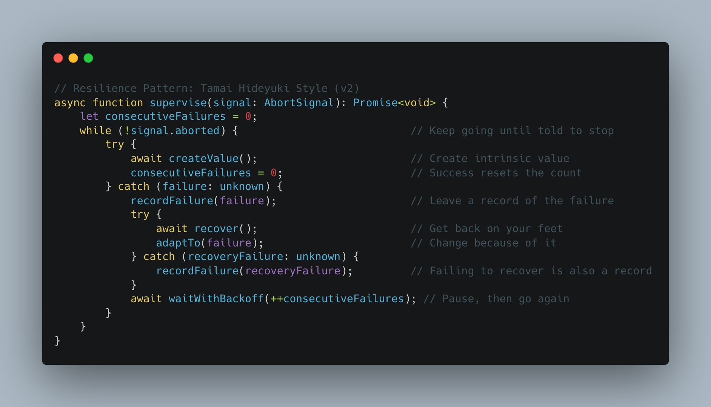

<!-- Typing Banner -->

  

  

  

---

<h2 align="center">Recent Work</h2>

| Repository | Description |
|--------------|------|
| [heyawari](https://github.com/tamai-hideyuki/heyawari) | A meeting-room booking system. The core design decision: double bookings are prevented by a PostgreSQL exclusion constraint (`EXCLUDE USING gist` + `tstzrange`) rather than by application-side checks, so concurrent requests are reliably stopped at the DB level. pnpm monorepo with Hono + Drizzle + React (TanStack Router / Query) |
| [stardust-notes](https://github.com/tamai-hideyuki/stardust-notes) | A notepad where your words become stars. On save, the text breaks into particles that form a star, and notes sharing keywords are linked into constellations (WebGL). Seed and clock are fixed so rendering is reproducible, and visual behavior is verified with unit, browser, and Playwright E2E tests |
| [brain-cabinet](https://github.com/tamai-hideyuki/brain-cabinet) | An "external brain" that understands the meaning of notes and visualizes how your thinking grows. Implements semantic search with local embeddings (MiniLM + HNSW), SM-2 spaced repetition, and drift analysis that tracks changes in thinking. Modular monolith with React + Three.js / Hono / SQLite + Drizzle, under continuous development with CI and tests |

---

<h2 align="center">🧰 Tech-Stack Badges</h2>

  <!-- 🐍 バックエンド -->
  
  
  
  
  

  <!-- 🎨 フロントエンド -->
  
  
  
  
  
  

  <!-- 🖥️ スクリプト -->
  
  

  <!-- 🧱 フレームワーク -->
  
  
  
  

  <!-- 🛠️ インフラ・自動化 -->
  
  
  
  
  
  
  

  <!-- 📱 PWA・オフライン -->
  
  
  

  <!-- ⚖️ 法・RAG・解析 -->
  
  
  
  
  
  

  <!-- 🖥️ コア技術 -->
  
  
  

  <!-- 📚 その他 -->
  
  
  
  
  
  

---
#### [日本語 ☞](../README.md)

<h2 align="center">🌱 Aspiring Developer Vision</h2>
I aspire to be an engineer who discovers problems through product development and solves them with technology.

Engineering is not merely the application of tools; it is the practice of confronting fundamental problems and continually seeking better ways forward. In daily development, I value a mindset that constantly questions “Why this specification?” and “What creates the most value?”, while using my own hands to explore better options.

My technical interests are wide-ranging, but rather than clinging to a single field, I believe in flexibly absorbing whatever knowledge or skills are needed to elevate product value and continuously grow.

Development cannot be achieved alone. By fostering psychological safety, maintaining transparency, and welcoming change, I aim to help the team succeed as a whole.

Ultimately, I seek to broaden my perspective and influence so that I can contribute not only to design and implementation, but also to decisions affecting the overall quality and growth of a product.

---

<h2 align="center">✅ Tamai Hideyuki — Repository Snapshot</h2>

## 🧠 AI, Semantic Search & Local LLM

| Repository | Description |
|--------------|------|
| [semantica-notes](https://github.com/tamai-hideyuki/semantica-notes) | A personal knowledge base that organizes and searches notes by meaning. Semantic search with Sentence-Transformers (LaBSE) + FAISS, built on Clean Architecture + DDD (Domain / UseCase / Interface / Infrastructure) |
| [rfc-chronicle](https://github.com/tamai-hideyuki/rfc-chronicle) | A tool that ingests IETF RFCs and offers SQLite FTS5 full-text search and Sentence-Transformers + FAISS semantic search via CLI / API. Works offline with a local cache |
| [local-code-ai](https://github.com/tamai-hideyuki/local-code-ai) | A CLI coding assistant integrated with Ollama that reads/writes files, searches code, and runs shell commands from natural language. A challenge to see how far a fully local setup can go |

---

## 🏛 Design & Architecture

| Repository | Description |
|--------------|------|
| [law-watch](https://github.com/tamai-hideyuki/law-watch) | A monitoring system for early detection of legal amendments. A Hono API + Next.js monorepo designed with Clean Architecture (4-layer DDD), with 200+ tests written via TDD in Vitest. PostgreSQL + Prisma |
| [non-functional-requirements](https://github.com/tamai-hideyuki/non-functional-requirements) | Learning non-functional requirements (performance, availability, observability, security, etc.) through implementation, using a URL shortener as the subject. Rate limiting, request IDs, structured logging, metrics, and security headers are implemented as middleware, each with tests |

---

## 🔌 Backend & API

| Repository | Description |
|--------------|------|
| [ec-api-sandbox](https://github.com/tamai-hideyuki/ec-api-sandbox) | Backend API for an e-commerce site. Built test-first with PHP 8.4 / Laravel 13 / Sanctum, centered on PHPUnit feature tests. API design rules (soft deletes, HTTP method usage) are documented, with automated tests in CI |
| [hourei-api-server](https://github.com/tamai-hideyuki/hourei-api-server) | A relay API server and search UI wrapping the e-Gov Law API (law list / full text / articles / updates). Laravel 12 + React + Tailwind, launched together with Nginx / PHP-FPM / MySQL via docker compose. Includes CI |

---

## 🖥 Desktop Apps

| Repository | Description |
|--------------|------|
| [browser](https://github.com/tamai-hideyuki/browser) | An Arc-style browser prototype. Electron + TypeScript + React + Vite + Zustand + better-sqlite3, with a deliberate separation of main / preload / UI processes. Requirements and detailed design documents are maintained in docs |

---

## 🎨 Graphics & 3D

| Repository | Description |
|--------------|------|
| [DepthWalk](https://github.com/tamai-hideyuki/DepthWalk) | A pseudo-3D exploration game engine using ray casting. Built with the Canvas 2D API and TypeScript, supporting multi-floor movement, indoor/outdoor transitions, and vertical camera pitch |
| [inner-cosmos](https://github.com/tamai-hideyuki/inner-cosmos) | A "breathing sphere" built with Three.js + TypeScript. Scale animation with synchronized emissive glow and Bloom post-processing: creating visuals with shaders and materials instead of CSS |

---

## 🛠 CLI, Automation & Benchmarking

| Repository | Description |
|--------------|------|
| [devsetup](https://github.com/tamai-hideyuki/devsetup) | An interactive CLI that automates Docker-based development environment setup for Laravel + Breeze + OAuth / Symfony / MySQL / Nginx. Modular structure lets you pick reproducible configuration patterns from a menu |
| [m4-sustained-performance-lab](https://github.com/tamai-hideyuki/m4-sustained-performance-lab) | A benchmark tool comparing the power-limited sustained performance of a MacBook Pro (M4 Pro) and a MacBook Air (M4). Measures power with `powermetrics` and quantifies the gap between burst and sustained performance |

---

## 🔐 Security & Authentication

| Repository | Description |
|--------------|------|
| [VulnLab-TS](https://github.com/tamai-hideyuki/VulnLab-TS) | Security learning material aiming to explain fixes in code, e.g. why this change eliminates SQL injection. Reproduces vulnerabilities and implements their fixes with TypeScript + Hono / Express + SQLite |
| [lt-oauth-reintro](https://github.com/tamai-hideyuki/lt-oauth-reintro) | Lightning-talk materials re-introducing OAuth. Explains the internals of Symfony (KnpUOAuth2ClientBundle) and the design-philosophy differences from Laravel with slides, code, and diagrams |

---

## 📡 IoT

| Repository | Description |
|--------------|------|
| [picoW-E](https://github.com/tamai-hideyuki/picoW-E) | OLED display, Wi-Fi monitoring, and browser-controlled LEDs on Raspberry Pi Pico W + MicroPython. Builds an HTTP server that stores temperature, humidity, and pressure from a BME280 sensor and plots them as graphs |

---

> This page is continuously updated.

### [📚 Notes (Japanese) ☞](./learning-journal.md)
